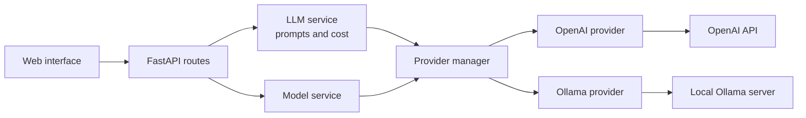

# Universal LLM Wrapper

A FastAPI gateway that puts local and hosted LLMs behind one API. Clients choose a provider and model per request, and get either a complete response or a token stream.

The project currently ships a programming tutor as its first use case, with a minimal web interface and an early prompt evaluation script.

The project is in early development. The core request flow is in place, and several known bugs are listed below. Automated tests, observability and agent features are planned.

## Features

- Multiple providers: OpenAI and Ollama, selected per request
- Two response modes: complete responses (`/chat`) and streaming (`/chat/stream`)
- Model discovery: `/models` lists the models available from each provider
- Error mapping: provider failures are mapped to HTTP errors (`400`, `401`, `503`)
- Token and cost reporting: `/chat` returns token counts and a cost based on a pricing table
- Versioned prompts: tutor prompts are kept as separate versions so they can be compared
- Web interface: a small HTML and JavaScript client that displays streamed responses

## Architecture



Routes handle HTTP concerns, services handle prompts and cost, and each provider module handles communication with one backend. The provider manager resolves a provider name to its module, so the rest of the application doesn't depend on a specific provider.

```text
backend/
  app/
    main.py            API routes and HTTP error mapping
    schemas.py         Request and response models
    exception.py       Application exceptions
    config/pricing.py  Per-model prices
    prompts/           Tutor and judge prompts
    providers/         OpenAI and Ollama modules, provider manager
    services/          Response generation and model listing
  prompt_eval.py       Prompt evaluation script (in progress)
  tests/prompt_cases.py  Evaluation cases
frontend/              Web interface
```

## Getting started

### Prerequisites

- Python 3
- An OpenAI API key (currently required at startup, see [Known issues](#known-issues))
- Optional: [Ollama](https://ollama.com) running locally, with at least one model pulled

### Run the backend

```bash
git clone https://github.com/Narta1/universal-llm-wrapper.git
cd universal-llm-wrapper/backend

python -m venv .venv
source .venv/bin/activate          # Windows: .venv\Scripts\activate
pip install -r app/requirements.txt

echo "OPENAI_API_KEY=your-key-here" > .env

uvicorn app.main:app --reload
```

The API runs at `http://127.0.0.1:8000`, with interactive documentation at `http://127.0.0.1:8000/docs`.

### Run the web interface

Serve `frontend/` on port 5500, the origin the backend allows through CORS:

```bash
cd frontend
python -m http.server 5500 --bind 127.0.0.1
```

Then open `http://127.0.0.1:5500`.

## API

| Method | Endpoint | Description |
|---|---|---|
| `GET` | `/` | Health check |
| `GET` | `/models` | List available models by provider |
| `POST` | `/chat` | Return a complete response with token counts and cost |
| `POST` | `/chat/stream` | Stream the response as plain text |

Both `POST` endpoints take the same request body:

```json
{
  "prompt": "What is a variable in Python?",
  "provider": "ollama",
  "model": "llama3.2:latest",
  "level": "beginner",
  "length": "short"
}
```

Example request:

```bash
curl -N http://127.0.0.1:8000/chat/stream \
  -H "Content-Type: application/json" \
  -d '{"prompt": "What is a variable in Python?", "provider": "ollama", "model": "llama3.2:latest", "level": "beginner", "length": "short"}'
```

Response format for `/chat`:

```json
{
  "output_tokens": 0,
  "input_tokens": 0,
  "response": "...",
  "model": "llama3.2:latest",
  "provider": "ollama",
  "status": "ok",
  "cost": 0
}
```

## Known issues

- `/models` returns a `500` when Ollama is unavailable, including for OpenAI models
- Rate limits and other unmapped provider errors return a generic `500`
- Errors in the middle of a stream are not handled
- `/chat/stream` does not report token usage or cost
- `prompt_eval.py` fails with a `NameError`, and its judge does not receive the question or expected answer
- `backend/requirements.txt` is incomplete; use `backend/app/requirements.txt` for now

## Roadmap

1. Fix the known issues, with a regression test for each
2. Structured logging of latency, tokens, cost and errors
3. A shared provider contract, tested by adding Anthropic
4. Tool calling and an agent loop with iteration and cost limits
5. Automated evaluation of prompts, models and agent behavior
6. RAG over technical documents, with retrieval evaluation
7. Docker deployment and continuous integration

## Tech stack

Python, FastAPI, Pydantic, OpenAI Python SDK, httpx, Ollama, HTML and JavaScript